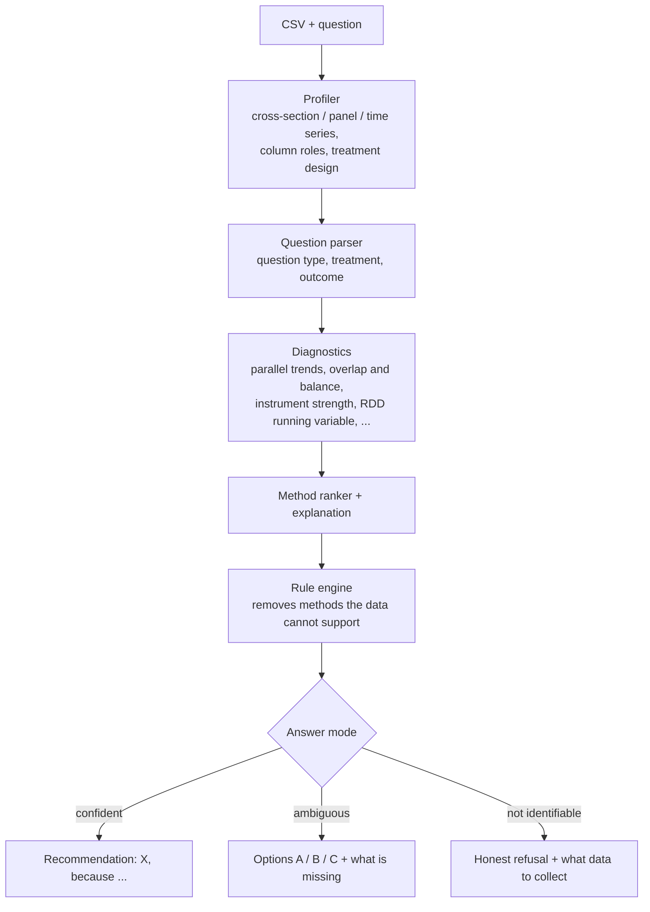

# Causal Method Advisor

[](https://github.com/KernerlRace/causal-method-advisor/actions/workflows/tests.yml)

[](LICENSE)

Give it a CSV and a question in plain language — *"Did the campaign raise sales?"*,
*"What drives churn?"* — and it recommends which causal inference method to use, and why.
If the question is ambiguous or the data cannot answer it, it says so and offers alternatives.

**▶ Live demo: [causal-method-advisor.streamlit.app](https://causal-method-advisor.streamlit.app)** — pick a demo dataset and press *Advise*.
<sub>The free hosting sleeps when idle — the first load can take up to a minute.</sub>

The goal is a small language model written and trained from scratch (no pretrained weights, no Hugging Face)
that understands the question and explains the choice, while deterministic code does the statistics.
The model exists and trains; the web demo still runs on a classical-ML baseline until the model is wired in.

> **Status:** the non-neural half is done — knowledge base, diagnostics, synthetic data, baseline and web UI.
> The model's own BPE tokenizer and the 34M-parameter GPT-style decoder are written from scratch; a first 12-minute
> run already beat the baseline on held-out questions, and the model is now pretrained on an open corpus of Wikipedia
> articles and a causal-inference handbook. Next: fine-tuning on the task with constrained decoding.


On the real Prop 99 data the advisor sees one treated state, 38 controls and pre-treatment trends that are
not parallel (p ≈ 1e-6), so it steers away from plain difference-in-differences:


## How it works



The parser and the ranker are pluggable backends: today a classical-ML baseline, later the from-scratch model.
Statistics are always computed by code, never by the model — small language models make unpredictable
mistakes in causal reasoning, so the model only reads the question and explains.

## What is inside

| Part | What it does |
|---|---|
| `knowledge/methods/*.yaml` | 22 method cards: requirements, assumptions, arguments for and against |
| `advisor/profiler.py` | CSV structure: cross-section / panel / time series, treatment design in panels |
| `advisor/diagnostics.py` | parallel trends, synthetic control fit, overlap and balance, RDD running variable search, instrument strength, non-Gaussianity |
| `advisor/rules.py` | which methods are allowed, allowed with caveats, or ruled out — and why |
| `advisor/estimators.py` | reference estimators: DiD, SC, SDID, IV, RDD, AIPW, DML, ITS, ... On California Prop 99 they match Facure's results: DiD −27.35, SC −19.51, SDID −15.61 |
| `datagen/scenarios/` | 17 scenario generators (experiments, back-door, IV, front-door, RDD, DiD, SC/SDID, staggered adoption, time series, structure discovery, unidentifiable and non-causal questions) × 7 subject domains, each with a known correct answer |
| `datagen/questions.py`, `explanations.py` | user questions (~120 templates, EN with ~15% RU, typos, conversational style) and target explanations whose numbers come from the diagnostics |
| `advisor/baseline.py` | baseline backend: TF-IDF + logistic regression for question parsing, gradient boosting over (question × column) pairs, one model per method for ranking |
| `advisor/pipeline.py` | end-to-end `advise(df, question, backend)` |
| `app.py` | Streamlit UI: upload a CSV or pick a demo → ask → review the parsed roles → get advice, assumption checks and method cards |
| `model/tokenizer.py` | byte-level BPE written from scratch: 16,384 tokens learned on the open corpus and the task data, 37 of them special (markup, question types, answer modes, one token per method); any string round-trips losslessly, and user text cannot smuggle in special tokens |
| `model/transformer.py` | GPT-style decoder written from scratch: pre-norm blocks with RMSNorm, rotary position embeddings, SwiGLU, hand-written causal attention, tied embeddings, KV cache for generation — 34M parameters with the 16k vocabulary |
| `model/data.py`, `train_pretrain.py`, `sample.py` | texts → token stream on disk → training loop (AdamW, warmup + cosine, bf16, gradient accumulation, resumable checkpoints) → sampling |
| `datagen/corpus.py` | pretraining corpus: Wikipedia EN/RU articles on statistics, econometrics, causal inference and ML (plus everyday domains), Facure's handbook, our method cards and explanations; resumable polite fetching, cleaning, deduplication, document-level train/val split |
| `data/demo/` | 12 demo datasets with questions, including the real Prop 99 data |

## Results

Baseline on the held-out test set (4,970 questions, split by scenario; `eval/results/baseline_test.json`):

| Metric | Baseline | Rules only |
|---|---|---|
| Best method, given a correct parse (top-1) | 99.9% | 69.1% |
| End-to-end top-1 | 83.6% | — |
| Treatment and outcome found correctly | 85.4% | — |
| Question type / on unseen templates | 98.2% / 78.9% | — |

The baseline's weak spots are synonyms (*salary* ↔ `annual_pay`) and unfamiliar phrasing —
exactly what the language model is meant to fix.

Tokenizer (`models/tokenizer.json`). The first version learned only the task's templates; retrained on the open
corpus plus the task data (~100M characters, 63 s), it reads ordinary text far more efficiently:

| Characters per token | Stage 5: 8k, task data only | Now: 16k, corpus + task data |
|---|---|---|
| Held-out task examples, EN / RU | 4.9 / 5.4 | 4.9 / 5.2 |
| Held-out Wikipedia articles, EN / RU | 2.6 / 2.1 | 4.2 / 3.6 |
| This README / PLAN.md (Russian) | 2.2 / 2.0 | 2.9 / 2.7 |

A full training example is 396 tokens at the median and 829 at most, so it still fits the 1,024-token context.

Language model, first check (`model/transformer.py`, 29.9M parameters with the stage 5 vocabulary). It memorizes a single batch — loss 9.0 → 0.0002
in 300 steps — and after 12 minutes of training on the task texts (1.1 epochs of 35M tokens, 55k tokens/s
on an RTX 3060 Ti in bf16, validation loss 0.42) it writes complete answers in the task format.
Greedy decoding on the same 4,970 test questions (`runs/` is not in git; reproduce with `python -m model.sample checkpoints/sft_lm.pt --n 5000`):

| Metric | Model, 12 min of training | Baseline |
|---|---|---|
| Question type / on unseen templates | 99.3% / 92.0% | 98.2% / 78.9% |
| Treatment and outcome found correctly | 97.2% | 85.4% |
| Whole parse exactly right | 93.7% | 81.6% |
| Best method, given the true parse and diagnostics (top-1) | 99.8% | 99.9% |

This is a sanity check, not the finished advisor. The loss covers the whole sequence rather than only the answer,
there is no constrained decoding yet, and the test questions come from the same generator. Free sampling shows
why constrained decoding is planned: the model writes a question about an `instrument` column that its own data card
does not have. Questions written by people are the real test.

Pretraining (`model/train_pretrain.py`; checkpoints are not in git). The 34M-parameter model trained for 54 minutes
on the open corpus: 4,000 steps of 32,768 tokens (131M tokens, 5.6 epochs of 23M), 44.7k tokens/s, learning rate 1e-3
with cosine decay to 1e-4, dropout 0.1. Validation loss levels off at 2.84 as the learning rate reaches its floor
(the first 200 steps, which start at ln 16,384 ≈ 9.7, are not shown):

<picture>
  <source media="(prefers-color-scheme: dark)" srcset="docs/img/pretrain_loss_dark.png">
  
</picture>

| Held-out text | Loss | Perplexity |
|---|---|---|
| English Wikipedia (175 articles) | 3.25 | 25.8 |
| Russian Wikipedia (42 articles) | 3.37 | 28.9 |
| Our explanations | 0.41 | 1.5 |

The model writes fluent, Wikipedia-shaped English with little meaning behind it — the first sample for a neutral prompt:

> **In statistics, the median is** the median with the lowest mean. It can be shown that the median is the mean of the
> tails of the tails, but it is easy to use.

Russian, with six times less text, is weaker and slips into repetition, and domain terms often pull the model into the
style of our explanations, which it has learned best. That is about what 34M parameters and 23M tokens can give; the
question for the next stage is whether this language prior helps on questions written by people, so fine-tuning
will be compared with and without it.

## Quick start

Windows with an NVIDIA GPU, using [uv](https://docs.astral.sh/uv/):

```bash
uv venv --python 3.12 .venv
uv pip install --python .venv/Scripts/python.exe torch --index-url https://download.pytorch.org/whl/cu126
uv pip install --python .venv/Scripts/python.exe -r requirements.txt
.venv/Scripts/python.exe scripts/check_env.py
```

The last command checks the libraries, GPU visibility and runs a short fp16 training step.

Run the web UI with the baseline:

```bash
.venv/Scripts/python.exe -m datagen.build --n 50000 --seed 1 --workers 9
.venv/Scripts/python.exe -m datagen.build_sft --per-scenario 2
.venv/Scripts/python.exe scripts/train_baseline.py --max-parser 40000
.venv/Scripts/streamlit run app.py
```

Other entry points:

```bash
.venv/Scripts/python.exe scripts/demo_stage1.py data/demo/smoking.csv --treatment california --outcome cigsale
.venv/Scripts/python.exe -m eval.run_eval --backend baseline
.venv/Scripts/python.exe -m datagen.corpus titles --lang en      # then --lang ru
.venv/Scripts/python.exe -m datagen.corpus wiki --lang en        # ~50 min; then --lang ru
.venv/Scripts/python.exe -m datagen.corpus facure
.venv/Scripts/python.exe -m datagen.corpus own
.venv/Scripts/python.exe -m model.train_tokenizer --vocab-size 16384 --corpus
.venv/Scripts/python.exe -m model.data corpus --splits train val
.venv/Scripts/python.exe -m model.train_pretrain --steps 4000 --warmup 200 --lr 1e-3 --min-lr 1e-4 --dropout 0.1 --run pretrain
.venv/Scripts/python.exe -m model.sample checkpoints/pretrain_best.pt --loss data/tokens/pretrain_val_wiki_en.bin data/tokens/pretrain_val_wiki_ru.bin data/tokens/pretrain_val_own.bin
.venv/Scripts/python.exe -m model.data sft --splits train val
.venv/Scripts/python.exe -m model.train_pretrain --train data/tokens/sft_train.bin --overfit --steps 300 --batch 8 --accum 1 --lr 1e-3 --min-lr 1e-3 --weight-decay 0 --run overfit
.venv/Scripts/python.exe -m model.train_pretrain --train data/tokens/sft_train.bin --val data/tokens/sft_val.bin --steps 1200 --run sft_lm
.venv/Scripts/python.exe -m model.sample checkpoints/sft_lm.pt --sft test:0
.venv/Scripts/python.exe -m pytest -q tests
```

## Roadmap

- [x] Method cards, profiler, diagnostics, rule engine
- [x] Scenario generators with known ground truth, reference estimators
- [x] Question and explanation generators, train/val/test sets
- [x] Classical-ML baseline, end-to-end pipeline, web UI
- [x] Byte-level BPE tokenizer from scratch
- [x] GPT-style decoder from scratch (~30M parameters: attention, RoPE, RMSNorm written by hand)
- [x] Pretraining on an open corpus (Wikipedia EN/RU, Facure's handbook, 23M tokens)
- [ ] Fine-tuning on the task, constrained decoding, two-pass inference — must beat the baseline
- [ ] Calibrated confidence, "options" mode and honest refusals
- [ ] Evaluation against the baselines, demo scenarios

The detailed design document (in Russian) is in [PLAN.md](PLAN.md).

## References

- Aleksander Molak, *Causal Inference and Discovery in Python* — used only as a source of knowledge for the method cards,
  never as training text
- Matheus Facure, *Causal Inference for the Brave and True*

## Pretraining data

The pretraining corpus is rebuilt locally by `datagen/corpus.py` and is not stored in this repository:

| Source | Licence | What is used |
|---|---|---|
| [Wikipedia](https://www.wikipedia.org/), English and Russian | [CC BY-SA 4.0](https://creativecommons.org/licenses/by-sa/4.0/) | plain-text articles from statistics, econometrics, causal inference and machine learning categories, plus marketing, health, labour, education and retail articles for everyday vocabulary |
| [Causal Inference for the Brave and True](https://github.com/matheusfacure/python-causality-handbook) by Matheus Facure | MIT | prose of the book's chapters (no code) |
| This project | MIT | method cards and generated explanations from the training split |
