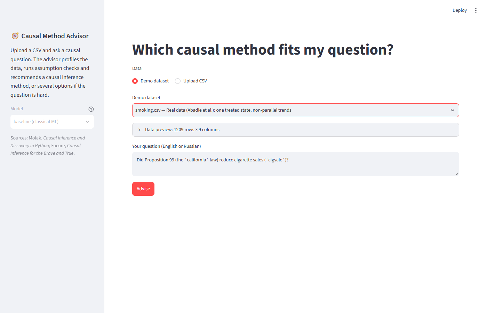
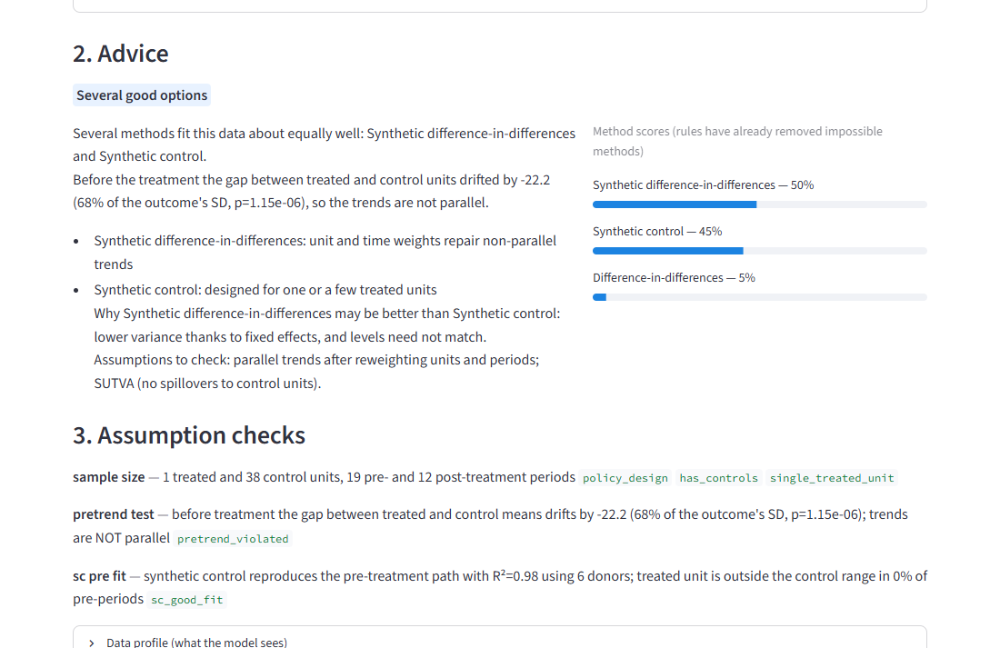
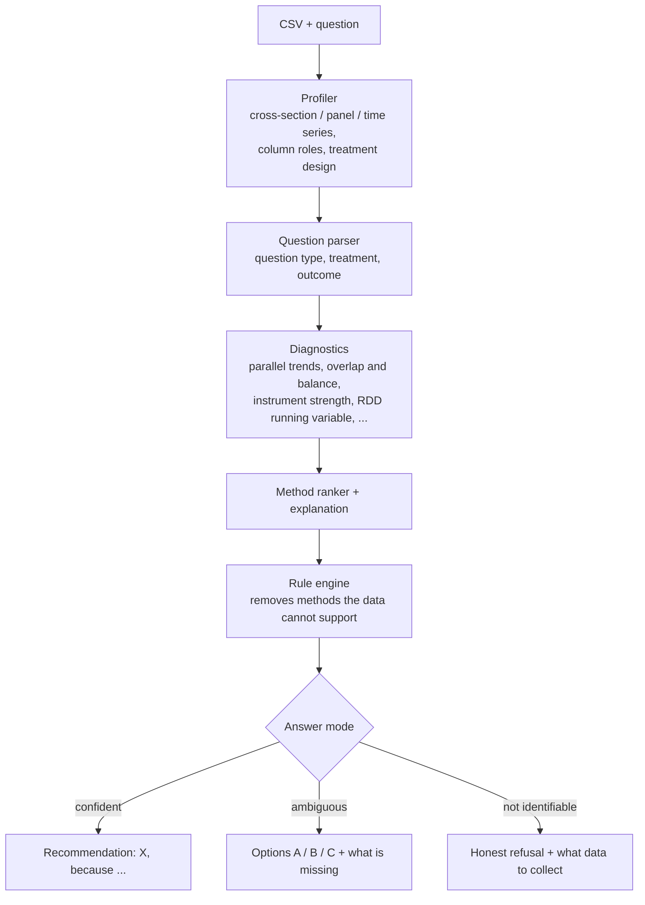

# Causal Method Advisor

[](https://github.com/KernerlRace/causal-method-advisor/actions/workflows/tests.yml)

[](LICENSE)

Give it a CSV and a question in plain language — *"Did the campaign raise sales?"*,
*"What drives churn?"* — and it recommends which causal inference method to use, and why.
If the question is ambiguous or the data cannot answer it, it says so and offers alternatives.

The goal is a small language model written and trained from scratch (no pretrained weights, no Hugging Face)
that understands the question and explains the choice, while deterministic code does the statistics.
The model is the next stage; today the pipeline runs end to end on a classical-ML baseline.

> **Status:** the non-neural half is done — knowledge base, diagnostics, synthetic data, baseline and web UI.
> Next: the from-scratch model (BPE tokenizer, GPT-style decoder, pretraining and fine-tuning).



On the real Prop 99 data the advisor sees one treated state, 38 controls and pre-treatment trends that are
not parallel (p ≈ 1e-6), so it steers away from plain difference-in-differences:



## How it works



The parser and the ranker are pluggable backends: today a classical-ML baseline, later the from-scratch model.
Statistics are always computed by code, never by the model — small language models make unpredictable
mistakes in causal reasoning, so the model only reads the question and explains.

## What is inside

| Part | What it does |
|---|---|
| `knowledge/methods/*.yaml` | 22 method cards: requirements, assumptions, arguments for and against |
| `advisor/profiler.py` | CSV structure: cross-section / panel / time series, treatment design in panels |
| `advisor/diagnostics.py` | parallel trends, synthetic control fit, overlap and balance, RDD running variable search, instrument strength, non-Gaussianity |
| `advisor/rules.py` | which methods are allowed, allowed with caveats, or ruled out — and why |
| `advisor/estimators.py` | reference estimators: DiD, SC, SDID, IV, RDD, AIPW, DML, ITS, ... On California Prop 99 they match Facure's results: DiD −27.35, SC −19.51, SDID −15.61 |
| `datagen/scenarios/` | 17 scenario generators (experiments, back-door, IV, front-door, RDD, DiD, SC/SDID, staggered adoption, time series, structure discovery, unidentifiable and non-causal questions) × 7 subject domains, each with a known correct answer |
| `datagen/questions.py`, `explanations.py` | user questions (~120 templates, EN with ~15% RU, typos, conversational style) and target explanations whose numbers come from the diagnostics |
| `advisor/baseline.py` | baseline backend: TF-IDF + logistic regression for question parsing, gradient boosting over (question × column) pairs, one model per method for ranking |
| `advisor/pipeline.py` | end-to-end `advise(df, question, backend)` |
| `app.py` | Streamlit UI: upload a CSV or pick a demo → ask → review the parsed roles → get advice, assumption checks and method cards |
| `data/demo/` | 12 demo datasets with questions, including the real Prop 99 data |

## Results

Baseline on the held-out test set (4,970 questions, split by scenario; `eval/results/baseline_test.json`):

| Metric | Baseline | Rules only |
|---|---|---|
| Best method, given a correct parse (top-1) | 99.9% | 69.1% |
| End-to-end top-1 | 83.6% | — |
| Treatment and outcome found correctly | 85.4% | — |
| Question type / on unseen templates | 98.2% / 78.9% | — |

The baseline's weak spots are synonyms (*salary* ↔ `annual_pay`) and unfamiliar phrasing —
exactly what the language model is meant to fix.

## Quick start

Windows with an NVIDIA GPU, using [uv](https://docs.astral.sh/uv/):

```bash
uv venv --python 3.12 .venv
uv pip install --python .venv/Scripts/python.exe torch --index-url https://download.pytorch.org/whl/cu126
uv pip install --python .venv/Scripts/python.exe -r requirements.txt
.venv/Scripts/python.exe scripts/check_env.py
```

The last command checks the libraries, GPU visibility and runs a short fp16 training step.

Run the web UI with the baseline:

```bash
.venv/Scripts/python.exe -m datagen.build --n 50000 --seed 1 --workers 9
.venv/Scripts/python.exe -m datagen.build_sft --per-scenario 2
.venv/Scripts/python.exe scripts/train_baseline.py --max-parser 40000
.venv/Scripts/streamlit run app.py
```

Other entry points:

```bash
.venv/Scripts/python.exe scripts/demo_stage1.py data/demo/smoking.csv --treatment california --outcome cigsale
.venv/Scripts/python.exe -m eval.run_eval --backend baseline
.venv/Scripts/python.exe -m pytest -q tests
```

## Roadmap

- [x] Method cards, profiler, diagnostics, rule engine
- [x] Scenario generators with known ground truth, reference estimators
- [x] Question and explanation generators, train/val/test sets
- [x] Classical-ML baseline, end-to-end pipeline, web UI
- [ ] Byte-level BPE tokenizer from scratch
- [ ] GPT-style decoder from scratch (~30M parameters: attention, RoPE, RMSNorm written by hand)
- [ ] Pretraining on an open corpus
- [ ] Fine-tuning on the task, constrained decoding, two-pass inference — must beat the baseline
- [ ] Calibrated confidence, "options" mode and honest refusals
- [ ] Evaluation against the baselines, demo scenarios

The detailed design document (in Russian) is in [PLAN.md](PLAN.md).

## References

- Aleksander Molak, *Causal Inference and Discovery in Python*
- Matheus Facure, *Causal Inference for the Brave and True*
