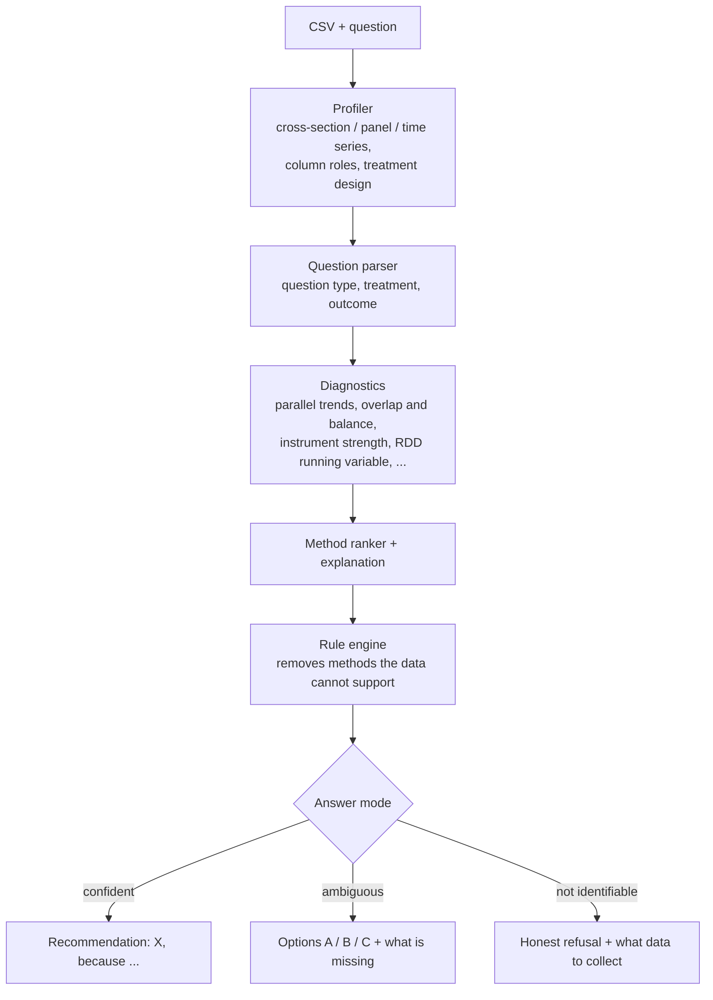
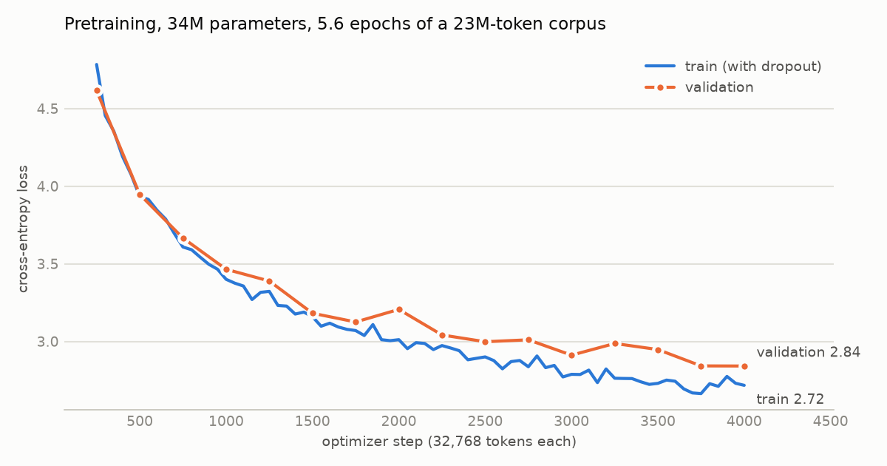
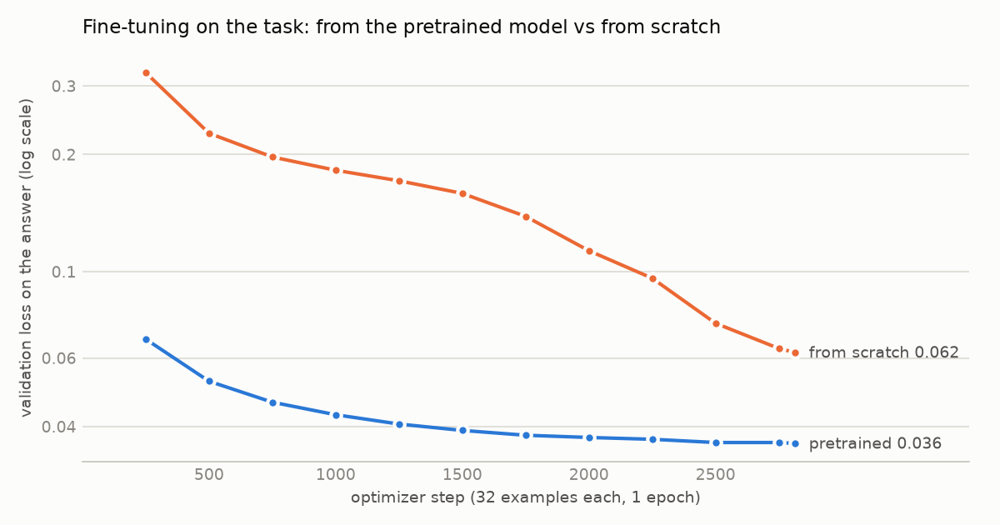
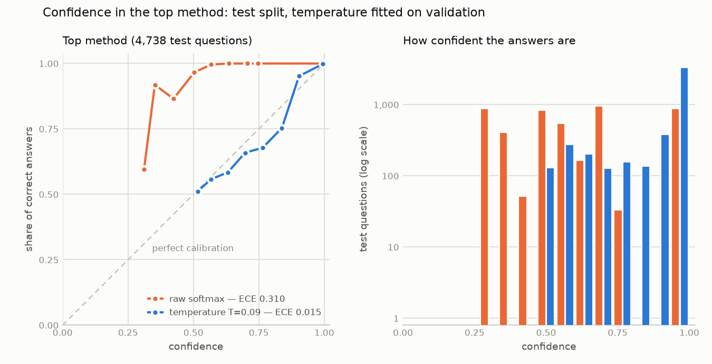

# Causal Method Advisor

[](https://github.com/KernerlRace/causal-method-advisor/actions/workflows/tests.yml)

[](LICENSE)

Give it a CSV and a question in plain language — *"Did the campaign raise sales?"*,
*"What drives churn?"* — and it recommends which causal inference method to use, and why.
If the question is ambiguous or the data cannot answer it, it says so and offers alternatives.

**▶ Live demo: [causal-method-advisor.streamlit.app](https://causal-method-advisor.streamlit.app)** — pick a demo dataset and press *Advise*.
<sub>The free hosting sleeps when idle — the first load can take up to a minute.</sub>

The goal is a small language model written and trained from scratch (no pretrained weights, no Hugging Face)
that understands the question and explains the choice, while deterministic code does the statistics.
The model is trained and wired into the app; the online demo runs the classical-ML baseline, because the free
hosting has no PyTorch — run the app locally to talk to the model.

> **Status:** CausalGPT-mini — our own BPE tokenizer and a 34M-parameter GPT-style decoder, pretrained on Wikipedia
> articles and a causal-inference handbook, then fine-tuned on the task — answers through the full pipeline with
> constrained decoding. On 93 hand-written questions the shipped run picks the right method end to end 68% of the time
> (other runs of the same recipe: 73–79%), against 58% for the classical baseline, and writes its own explanations,
> checked number by number against the data. Its confidence is calibrated (expected calibration error on held-out template questions 0.018
> instead of 0.326), and answers it is unsure of become options instead of a recommendation. When treatment is almost
> decided by the covariates, both backends now offer trimmed or matched estimates instead of a confident regression.
> When it is unsure how it read the question it says so and asks to confirm the roles; on the Prop 99 demo the current
> model misreads the treatment as `state` and asks about it. Next: questions written by other people, and a rebuild of
> the panel training data.


On the real Prop 99 data the advisor sees one treated state, 38 controls and pre-treatment trends that are
not parallel (p ≈ 1e-6), so it steers away from plain difference-in-differences:


## How it works



The parser and the ranker are pluggable backends: the classical-ML baseline or the from-scratch model.
Statistics are always computed by code, never by the model — small language models make unpredictable
mistakes in causal reasoning, so the model only reads the question, ranks the methods and explains.

The model runs in two passes. Pass 1 reads the data profile and the question and writes the parse under
**constrained decoding**: every allowed continuation (`treatment=` + each column of *this* CSV, `randomized=yes`, ...,
end of parse) is tokenised into a prefix tree, and each step picks only among the children of the current node, so the
model cannot name a column the data does not have. The probability of every choice is kept; when the reading is less
certain than on 99% of familiar questions, the advisor asks the user to confirm the weakest part of it (stage 9, part 2
below). Pass 2 sees the diagnostics and the rule verdicts; the answer mode
and the method probabilities are read from the softmax over the special `<MODE:*>` and `<M:*>` tokens, rules remove
forbidden methods, a calibrated confidence decides between a recommendation, options and a refusal (stage 9 below),
and the model writes the explanation. The explanation is shown only if every number and percentage
in it appears in the model's input and it names the top method; otherwise a template explanation built from the same
facts is used, and the UI says so.

## What is inside

| Part | What it does |
|---|---|
| `knowledge/methods/*.yaml` | 22 method cards: requirements, assumptions, arguments for and against |
| `advisor/profiler.py` | CSV structure: cross-section / panel / time series, treatment design in panels |
| `advisor/diagnostics.py` | parallel trends, synthetic control fit, overlap and balance, RDD running variable search, instrument strength, non-Gaussianity |
| `advisor/rules.py` | which methods are allowed, allowed with caveats, or ruled out — and why |
| `advisor/estimators.py` | reference estimators: DiD, SC, SDID, IV, RDD, AIPW, DML, ITS, ... On California Prop 99 they match Facure's results: DiD −27.35, SC −19.51, SDID −15.61 |
| `datagen/scenarios/` | 18 scenario generators (experiments, back-door with good and poor overlap, IV, front-door, RDD, DiD, SC/SDID, staggered adoption, time series, structure discovery, unidentifiable and non-causal questions) × 7 subject domains, each with a known correct answer |
| `datagen/questions.py`, `explanations.py` | user questions (~120 templates, EN with ~15% RU, typos, conversational style) and target explanations whose numbers come from the diagnostics |
| `advisor/baseline.py` | baseline backend: TF-IDF + logistic regression for question parsing, gradient boosting over (question × column) pairs, one model per method for ranking |
| `advisor/pipeline.py` | end-to-end `advise(df, question, backend)` |
| `app.py` | Streamlit UI: upload a CSV or pick a demo → ask → review the parsed roles → get advice, assumption checks and method cards |
| `model/tokenizer.py` | byte-level BPE written from scratch: 16,384 tokens learned on the open corpus and the task data, 37 of them special (markup, question types, answer modes, one token per method); any string round-trips losslessly, and user text cannot smuggle in special tokens |
| `model/transformer.py` | GPT-style decoder written from scratch: pre-norm blocks with RMSNorm, rotary position embeddings, SwiGLU, hand-written causal attention, tied embeddings, KV cache for generation — 34M parameters with the 16k vocabulary |
| `model/data.py`, `train_pretrain.py`, `sample.py` | texts → token stream on disk → training loop (AdamW, warmup + cosine, bf16, gradient accumulation, resumable checkpoints) → sampling |
| `model/sft.py`, `train_sft.py` | fine-tuning format and loop: loss only on the parse and the answer, a soft label (the gold weights of all suitable methods) at the position of the first method, logits computed only where there is a target |
| `model/decode.py` | two-pass inference with constrained decoding, method probabilities from the softmax, generated explanations with a fact check; `ask` and `export` commands |
| `model/limits.py` | load cap for training and evaluation: short pauses keep the GPU busy at most ~65% of the time, PyTorch threads capped at 75% of the cores |
| `eval/handwritten_questions.jsonl` | 93 questions written by hand outside the template grammar, with gold parses and methods; `eval/handwritten.py` scores any backend on them |
| `advisor/confidence.py` | calibrated confidence and the answer mode: temperature-scaled method probabilities, recommend / options / refuse; confidence in the parse and when to ask the user to confirm it; plain NumPy, so the app needs no PyTorch for it |
| `eval/calibrate.py` | fits the temperature, the answer-mode rule and the parse-confidence threshold on the validation split and reports on test (`models/calibration.json`, `eval/results/calibration.json`) |
| `eval/traps.py`, `eval/trap_questions.jsonl`, `data/traps/` | 48 trap questions where a confident recommendation is wrong — hidden confounding, no control group, prediction, poor overlap — on six datasets built by `scripts/make_traps.py` |
| `datagen/corpus.py` | pretraining corpus: Wikipedia EN/RU articles on statistics, econometrics, causal inference and ML (plus everyday domains), Facure's handbook, our method cards and explanations; resumable polite fetching, cleaning, deduplication, document-level train/val split |
| `data/demo/` | 12 demo datasets with questions, including the real Prop 99 data |

## Results

Baseline on the held-out test set (4,970 questions, split by scenario; `eval/results/baseline_test.json`):

| Metric | Baseline | Rules only |
|---|---|---|
| Best method, given a correct parse (top-1) | 99.9% | 69.1% |
| End-to-end top-1 | 83.6% | — |
| Treatment and outcome found correctly | 85.4% | — |
| Question type / on unseen templates | 98.2% / 78.9% | — |

The baseline's weak spots are synonyms (*salary* ↔ `annual_pay`) and unfamiliar phrasing —
exactly what the language model is meant to fix.

Tokenizer (`models/tokenizer.json`). The first version learned only the task's templates; retrained on the open
corpus plus the task data (~100M characters, 63 s), it reads ordinary text far more efficiently:

| Characters per token | Stage 5: 8k, task data only | Now: 16k, corpus + task data |
|---|---|---|
| Held-out task examples, EN / RU | 4.9 / 5.4 | 4.9 / 5.2 |
| Held-out Wikipedia articles, EN / RU | 2.6 / 2.1 | 4.2 / 3.6 |
| This README / PLAN.md (Russian) | 2.2 / 2.0 | 2.9 / 2.7 |

A full training example is 396 tokens at the median and 829 at most, so it still fits the 1,024-token context.

Language model, first check (`model/transformer.py`, 29.9M parameters with the stage 5 vocabulary). It memorizes a single batch — loss 9.0 → 0.0002
in 300 steps — and after 12 minutes of training on the task texts (1.1 epochs of 35M tokens, 55k tokens/s
on an RTX 3060 Ti in bf16, validation loss 0.42) it writes complete answers in the task format.
Greedy decoding on the same 4,970 test questions (`runs/` is not in git; reproduce with `python -m model.sample checkpoints/sft_lm.pt --n 5000`):

| Metric | Model, 12 min of training | Baseline |
|---|---|---|
| Question type / on unseen templates | 99.3% / 92.0% | 98.2% / 78.9% |
| Treatment and outcome found correctly | 97.2% | 85.4% |
| Whole parse exactly right | 93.7% | 81.6% |
| Best method, given the true parse and diagnostics (top-1) | 99.8% | 99.9% |

This is a sanity check, not the finished advisor. The loss covers the whole sequence rather than only the answer,
there is no constrained decoding yet, and the test questions come from the same generator. Free sampling shows
why constrained decoding is planned: the model writes a question about an `instrument` column that its own data card
does not have. Questions written by people are the real test.

Pretraining (`model/train_pretrain.py`; checkpoints are not in git). The 34M-parameter model trained for 54 minutes
on the open corpus: 4,000 steps of 32,768 tokens (131M tokens, 5.6 epochs of 23M), 44.7k tokens/s, learning rate 1e-3
with cosine decay to 1e-4, dropout 0.1. Validation loss levels off at 2.84 as the learning rate reaches its floor
(the first 200 steps, which start at ln 16,384 ≈ 9.7, are not shown):

<picture>
  <source media="(prefers-color-scheme: dark)" srcset="docs/img/pretrain_loss_dark.png">
  
</picture>

| Held-out text | Loss | Perplexity |
|---|---|---|
| English Wikipedia (175 articles) | 3.25 | 25.8 |
| Russian Wikipedia (42 articles) | 3.37 | 28.9 |
| Our explanations | 0.41 | 1.5 |

The model writes fluent, Wikipedia-shaped English with little meaning behind it — the first sample for a neutral prompt:

> **In statistics, the median is** the median with the lowest mean. It can be shown that the median is the mean of the
> tails of the tails, but it is easy to use.

Russian, with six times less text, is weaker and slips into repetition, and domain terms often pull the model into the
style of our explanations, which it has learned best. That is about what 34M parameters and 23M tokens can give; the
question for the next stage is whether this language prior helps on questions written by people, so fine-tuning
will be compared with and without it.

### Fine-tuning on the task (stage 8)

The pretrained model and a randomly initialised copy were fine-tuned identically for one epoch on the 90k training
examples (22 minutes each under the load cap; learning rate 3e-4 from the pretrained weights, 1e-3 from scratch):

<picture>
  <source media="(prefers-color-scheme: dark)" srcset="docs/img/sft_loss_dark.png">
  
</picture>

**Template test** (4,970 held-out questions, split by scenario; `eval/results/*_test.json`):

| Metric | Baseline | From scratch | Pretrained |
|---|---|---|---|
| Treatment and outcome found correctly | 85.4% | 98.5% | 98.6% |
| Whole parse exactly right | 81.6% | 96.9% | 97.1% |
| Question type / on unseen templates | 98.2% / 78.9% | 98.4% / 81.5% | 98.5% / 82.7% |
| Best method, given the true parse (top-1) | 99.9% | 99.5% | 99.2% |
| Best method end to end (top-1) | 83.6% | 97.8% | 98.1% |

**Hand-written questions** (93 questions, 69 English and 24 Russian, about the 12 demo datasets;
`eval/results/handwritten_*.json`). They were written outside the template grammar — synonyms instead of column
names (*"free delivery"* for `free_shipping`), informal text and typos, long context, Russian text with English column
names — with the gold answer taken from the scenario each dataset was generated from:

| Metric | Baseline | From scratch | Pretrained |
|---|---|---|---|
| Treatment and outcome found correctly | 65.6% | 83.9% | **86.0%** |
| Best method end to end (top-1, 80 questions) | 60.0% | 72.5% | **78.8%** |
| Answer mode end to end | 69.0% | 79.8% | 83.3% |
| Question type | **94.6%** | 84.9% | 87.1% |
| Context: randomised, hidden confounder, instrument, mediator, threshold | **80.6%** | 75.3% | 78.5% |
| Model's own explanation passes the fact check | — | 14.3% | **98.6%** |

The pretrained model beats the baseline by 18.8 points on the end-to-end method (paired bootstrap 95% CI +7.5 to +30.0;
20 questions only the model gets right, 5 only the baseline). Its gain is in linking the words of a question to a
column; given the correct parse, both pick the right method on all 80 questions. With 80 questions, the 6-point gap
between pretrained and from-scratch is within noise (CI −3.8 to +16.2). Pretraining shows where language matters: the
explanations. Both models learned the format, but the one trained from scratch fills it with numbers that are not in
the data, for example the pre-trend drift of the clinic panel as *108% of the outcome's SD* where the diagnostics say
1.72. With only 5% of the training examples the gap widens: validation loss 0.055 vs 0.211, and 71.6% vs 0%
of explanations pass the check.

An explanation written by the model for *"Only one of our clinics switched to the new drug, the rest kept the old
treatment. ... Did the new drug actually shorten recovery?"* — every number comes from the diagnostics:

> Several methods fit this data about equally well: Synthetic difference-in-differences and Synthetic control.
> Before the treatment the gap between treated and control units drifted by 8.27 (172% of the outcome's SD,
> p=4.17e-07), so the trends are not parallel. A synthetic control reproduces the treated path before the treatment
> well (R²=0.971). There is 1 treated unit and 38 control units, 24 periods before and 8 after the treatment. ...

What does not work yet. Context said differently from the templates — *"randomly assigned the flag"*,
*"a hard cutoff on appraisal_score"* — is missed, although the same fields are almost always right on template
questions; and the question type is worse than the baseline's on these questions (*"dose-response effect"* is read as
heterogeneity, *"causally related"* as a prediction question). On the Prop 99 demo question the pretrained model names
`age15to24` as the treatment, which the baseline gets right: the decoder picks a column token by token, and *"age"*
looked likely. Scoring each column by the probability of its whole name fixes that question but does worse overall
(80 → 78 of 93 roles for the pretrained model, 78 → 72 from scratch), because summed log-probabilities favour short
names, so token-by-token choice stays; the roles can be corrected in the UI. Fine-tuning puts the loss only on the answer, so the
model no longer learns to model the questions themselves: the type on unseen templates fell from 92.0% in the
stage 6 run to 82.7%. These 93 questions were written during development, not by outside users, so the next fixes
(an auxiliary loss on the question, a richer grammar for context) must be measured on questions from other people.

### Confidence, options and refusals (stage 9)

The method probabilities were trained on soft labels (the gold weights of every suitable method), so they say how well
each method fits, not how likely the top one is to be right: for *SDID 1.0, synthetic control 0.4, DiD 0.1* the target is
two thirds on SDID, although the top method is right 99.1% of the time. A single temperature fitted on the validation
split (`eval/calibrate.py`, T = 0.087) turns the scores into a probability of being right. When two methods are equally
best, either counts, half each, so 0.5 is the honest confidence there. On the test split the expected calibration error
falls from 0.310 to 0.015; the answer-mode token needed no correction (0.001, right 99.9% of the time):

<picture>
  <source media="(prefers-color-scheme: dark)" srcset="docs/img/calibration_dark.png">
  
</picture>

Three rules for the answer mode, compared on the true parse; the thresholds were grid-searched on validation by
balanced accuracy over the three modes:

| Rule | Validation | Test | Test recall: recommend / options / refuse |
|---|---|---|---|
| The model's `<MODE:*>` token | 99.9% | 99.9% | 99.8% / 100% / 100% |
| Confidence: options if the top method's probability is below 0.89 or its lead below 0.39 | 96.9% | 97.2% | 94.1% / 97.7% / 100% |
| **Either** of the two, whichever is more cautious (thresholds 0.23 and 0.02) | 99.9% | 99.9% | 99.8% / 100% / 100% |

Confidence alone is the worst rule. The gold calls an answer "options" when two methods both weigh at least 0.9, so
*DiD 1.0, SDID 0.8* is a recommendation and *SDID 1.0, synthetic control 0.9* is not. That line is about how close the
two methods are, and the top method is right in both cases; the token learned the line exactly, a probability of being
right cannot express it. The cautious combination ties the token on validation and was chosen by a protocol fixed before
any trap or hand-written run (ties go to the more cautious rule). In distribution it answers like the token. It changes
the answer when confidence collapses, which happens out of distribution. Confidence is the calibrated probability of
the top *allowed* method, not renormalised after the rules: if the model bet on a method the rules forbid, it misread the
data, and the answer becomes options instead of a confident recommendation of whatever is left. Refusals do not depend on
a threshold: a question that is not causal, every method ruled out, or sensitivity analysis on top (it bounds the
effect instead of estimating it).

**Traps** (`eval/traps.py`, 48 questions, 36 English and 12 Russian): questions where a confident recommendation is the
wrong answer, about six datasets built for this (`data/traps/`) and the demo data. The expected answer was fixed before
any model saw the questions, and an answer counts only with the right question type and roles:

| Trap | Expected | Baseline | Model, mode token | Model, calibrated |
|---|---|---|---|---|
| Hidden confounder named, no instrument or mediator (12) | refuse | 25% | 17% | 17% |
| No control group: every unit treated at once, or 5 weeks before the change (12) | options or refuse | 92% | 25% | **92%** |
| Prediction, not a causal question (12) | refuse | 50% | 67% | 67% |
| Poor overlap: treatment almost fixed by three covariates (12) | options or refuse | 0% | 0% | 0% |
| All 48 | | 42% | 27% | **44%** |
| All 48, given the correct parse | | 75% | 56% | **77%** |

On panels without a control group the model's own token says "recommend" 9 times out of 12. The model had bet on DiD or
synthetic control, the rules ruled them out, and the calibrated confidence in what was left is low, so the answer becomes
options. Building these traps also exposed a gap in the rule engine: a treatment switched on in every unit at the same
time was not recognised as a design at all, so DiD stayed allowed; the profiler now records it as a design with no
controls. The other rows are honest failures. On the two new datasets for hidden confounding and poor overlap the model's
parse breaks: it names `annual_spend` as the treatment and `income` or `age` as the outcome (roles right on 4 and 0 of
12 questions), while the baseline finds the roles but misses the hidden confounder. Poor overlap fails for every rule
even with the correct parse, because the training data never treats poor overlap as a reason for options.

**Hand-written questions, report only** (`eval/results/handwritten_causalgpt_calibrated.json`; nothing was tuned on
them). The answer mode end to end stays at 83.3% under either rule. The calibrated rule turned four answers into options,
three of them effect questions misread as heterogeneity questions, where confidence fell to 0.00–0.16 because the model's
choice was ruled out for that parse. Calibration transfers only partly: confidence averages 0.89 when the method is
right and 0.72 when it is wrong, the calibration error is 0.175 instead of 0.015, and of the 44 answers given with at
least 0.9 confidence 82% are right. Most errors here are parse errors, and pass 2 takes a wrong parse at face value, so
10 of 13 wrong answers still carry a confidence of 0.7 or more. The Prop 99 demo is one: with `age15to24` as the
treatment the model is 100% sure of regression. The UI therefore shows the number as confidence *if the roles in step 1
are right*, next to the roles the user can correct.

So the confidence is honest on data like the training data and catches one kind of failure outside it: the model's
choice being ruled out. It cannot see a wrong parse that looks consistent, and it cannot invent a caution the training
data never taught. That sets the next steps: a confidence for the parse itself, so the advisor can ask *"is the treatment
X?"* when unsure; poor overlap as an options case in the training data; and trap and live questions from other people,
because these 48, like the 93 hand-written ones, were written during development.

### Confidence in the parse (stage 9, part 2)

Pass 1 now keeps the probability of every choice it makes: the question type among the four `<T:*>` tokens, each field,
and each column, token by token among the tokens that still lead to a column of this CSV (that makes a proper
distribution over the columns; a test checks it against an explicit enumeration of the prefix tree). Their product is the
model's own probability that it read the type and the roles right (`Advisor.last_parse`, `advisor/confidence.py`).

The plan was to calibrate this number on the validation split, like the method confidence. There was nothing to calibrate
it on: the model parses all 4,988 validation questions correctly, because validation only has the phrasings it was trained
on (the held-out templates exist only in test). By a rule written down before the count was in, the advisor uses the
model's own probability as it is, and asks the user to confirm the roles below 0.9998, the level that flags 1 in 100
familiar questions. Everything below is report only:

| | Test, familiar templates (4,543) | Test, unseen templates (427) | Hand-written (93) | Traps (48) |
|---|---|---|---|---|
| Parse right (type and roles) | 99.98% | 82.7% | 86.0% | 47.9% |
| AUROC, right vs wrong parse | — (1 wrong) | 0.973 | 0.879 | 0.936 |
| Mean probability, right / wrong parse | — | 0.993 / 0.744 | 0.950 / 0.871 | 0.954 / 0.540 |
| Calibration error (ECE) | 0.0001 | 0.123 | 0.152 | 0.259 |
| Wrong parses it asks to confirm | 1 of 1 | 73 of 74 | 12 of 13 | 25 of 25 |
| Right parses it asks to confirm | 1.6% | 25% | 22.5% | 52% |

<sub>ECE with 15 bins on test and 10 on the two small sets, as in stage 9. On the whole test split ECE is 0.011 and AUROC 0.998,
but that is mostly the familiar templates.</sub>

The probability ranks parses well and is not calibrated outside the training phrasings: on unseen templates the model
averages 0.95 while 83% of its parses are right, and every wrong parse on test is a wrong question type. The threshold sits
so high that this does not stop it from catching errors: across the three sets outside the training phrasings it asks about
110 of 112 wrong parses, including every trap misread such as `annual_spend` as the treatment. On traps, 96% of the answers
are now either correct or a misread the advisor flags, against 44% correct. In the Prop 99 demo the model reads
`age15to24` as the treatment with probability 0.25, and instead of only a recommendation of regression at 100% confidence
the UI says
*"I'm not sure the treatment is `age15to24`"*, marks that field and shows the advice as provisional. The price is
asking about a quarter of the right parses on unfamiliar questions; confirming the roles with *Re-run with these
roles* removes the warning.

Parse confidence does not change the answer mode. "Options" means several methods fit these roles; "I may have misread
you" is a different message, and options built on a wrong treatment would still be wrong. What it cannot see: a
confident misread (one hand-written dose question read as a heterogeneity question at 0.99995), and wrong methods on a
right parse, which are 7 of the 17 wrong hand-written answers. A fitted calibration needs wrong parses from phrasings the
model has not seen, such as held-out templates in validation or questions from other people, and so does a threshold
with fewer false alarms.

### Poor overlap as an options case (stage 9, part 3)

The traps showed that no rule answered "options" when treatment is almost fixed by the covariates, even with the correct
parse. The cause was in the training gold, not in the model. The diagnostics already flag poor overlap (more than 10% of
units with a propensity score below 0.05 or above 0.95), but in the training data the flag appeared only in RDD, where it
holds by construction and the answer is RDD, and in 6% of the small back-door scenarios, where the gold still
recommended regression. A case with nearly half the units outside the overlap never appeared.

The fix is in the data, with no new threshold (`datagen/scenario.py`). Every back-door scenario that the existing flag
marks gets an options answer: doubly robust estimation after trimming the units with extreme propensity scores (the
effect where the groups overlap), or propensity score matching with a caliper (the effect for the matched units).
Regression ranks below them because it extrapolates silently, IPW last because of its extreme weights. RDD keeps
recommending RDD. A new scenario, `backdoor_targeted`, assigns treatment by a score of two to four covariates, from
moderate selection (about 5% extreme propensities) to an almost deterministic rule (about 70%), on 200 to 20,000 rows;
in 240 test draws the RDD search never mistook it for a single-variable threshold. The explanation names the problem with the
diagnostics' own numbers and says which effect each option estimates. The scenario ranges and the rule were fixed before
any trap or hand-written question saw a retrained model.

The new scenario is drawn by a second lottery, so every other seed keeps its scenario: 2,556 of the 50,000 scenarios were
rebuilt, 95% of the test questions are identical to stage 9's, and the before/after numbers below are close to paired.
Training gained 4,322 poor-overlap examples (4.8%). Both backends were retrained with the stage 8 recipe: the model
fine-tuned from the same pretrained checkpoint (21.5 minutes under the load cap, validation loss 0.0356 against 0.036),
and the calibration fitted again on validation by the stage 9 protocol (method temperature 0.086, test calibration error
0.326 → 0.018, the "either" rule again, 99.9% balanced accuracy on test).

| | Baseline, stage 9 → now | Model, stage 9 → now |
|---|---|---|
| Template test, poor overlap (242): answer mode, given the parse | 0% → **100%** | 1.2% → **100%** |
| Template test, poor overlap: best method, given the parse | 58.7% → 99.2% | 9.1% → 94.2% |
| Template test, all 4,986: best method end to end | 83.6% → 83.9% | 98.1% → 98.8% |
| Traps, poor overlap (12): end to end | 0% → **67%** | 0% → 8% |
| Traps, poor overlap: given the correct parse | 0% → **100%** | 8% → **100%** |
| Traps, all 48: end to end | 42% → **58%** | 44% → 40% |
| Traps, all 48: given the correct parse | 75% → **100%** | 77% → **100%** |
| Hand-written (93): best method end to end | 60.0% → 57.5% | 78.8% → 67.5% |
| Hand-written: answer mode end to end | 69.0% → 66.7% | 83.3% → 85.7% |

<sub>Model columns use the calibrated rule. The stage 9 numbers for the poor-overlap template subset were computed on the
new test split; the rest come from the committed stage 9 results.</sub>

With the correct parse, poor overlap now becomes options for both backends on every trap and every template question.
End to end the baseline gets 8 of the 12 poor-overlap traps, and its misses are parse errors. The model gets 1, because
it misreads the roles on these two datasets as it did in stage 9 (`income` or `age` taken as the outcome). The parse
check from part 2 asks the user to confirm all 11 of those misreads, so on these traps the advisor is now either right or
asks.

What got worse, and why:
- **Hand-written, method end to end, 78.8% → 67.5%.** 14 questions lost and 5 gained. None of the losses goes
  through the overlap logic: with the correct parse the model still picks the right method on all 80. Ten are pass 1
  reading the question differently: three Prop 99 questions where `cigsale` became the treatment and two questions that
  mention many covariates read as heterogeneity questions (the parse check asks about all five), an instrument or a
  hidden confounder dropped from the context (three, read with confidence above 0.9999, so not flagged), and two smaller
  slips. All five gains are pass 1 changes the other way. Pass 1's training target did not change, so this is
  run-to-run variation, and two control runs with another seed show it (table below). The other four losses are one close call on the A/B test demo: when the parse
  misses that the test was randomised, difference in means and regression were already nearly tied (0.49 vs 0.41) and
  they have now swapped (0.31 vs 0.44).
- **Traps, no control group, 92% → 67% end to end.** Three questions about the five-week newsletter series are now
  parsed with `emails_sent` as the treatment; with the correct parse every no-controls answer is still right.
- **Confidence on hand-written questions** no longer separates right from wrong answers (0.92 vs 0.91, calibration error
  0.29 instead of 0.18), because the new wrong answers are confident pass-2 answers to a wrong or incomplete parse.
- **Parse confidence**: the refitted threshold (0.99904 instead of 0.9998) catches 78 of 83 wrong parses outside the
  training phrasings (stage 9 model: 110 of 112). On unseen templates the model parses more questions right (90.4%
  against 82.7%), but its confidence separates right from wrong parses less well there (AUROC 0.875 against 0.973).

Two extra fine-tuning runs with another seed, one on the stage 9 data and one on the new data, separate the effect of
the data from the noise of a single run (report only; the shipped model is the seed fixed in the protocol, not the
better scorer):

| | Stage 9 data | Stage 9.3 data |
|---|---|---|
| Hand-written, best method end to end, seed 0 (the shipped models) | 78.8% | 67.5% |
| Hand-written, best method end to end, seed 1 | 72.5% | 72.5% |
| Traps, poor overlap given the correct parse, mode token, seed 0 / seed 1 | 0% / 0% | 100% / 100% |
| Traps, all 48 given the correct parse, mode token, seed 0 / seed 1 | 56% / 56% | 81% / 81% |

With the same seed the data change leaves the hand-written score where it was, while runs differ by 5 to 11 points;
the poor-overlap answer changes with the data in every run.

So the training gold now teaches the caution it was missing, and the end-to-end gains depend on the parse. Two
measurement problems also showed up. A single fine-tuning run moves the hand-written score by 5 to 11 points, so these
93 questions cannot rank models trained this way, and decisions need several runs or more questions. The scenario file
also turned out to carry synthetic-control fits from before the solver moved to cvxpy: rebuilding the panels with
current code changes an SC flag in about a fifth of them. The panel records were kept as they were, to change only one
thing at a time; a full rebuild comes next.

## Quick start

Windows with an NVIDIA GPU, using [uv](https://docs.astral.sh/uv/):

```bash
uv venv --python 3.12 .venv
uv pip install --python .venv/Scripts/python.exe torch --index-url https://download.pytorch.org/whl/cu126
uv pip install --python .venv/Scripts/python.exe -r requirements.txt
.venv/Scripts/python.exe scripts/check_env.py
```

The last command checks the libraries, GPU visibility and runs a short fp16 training step.

Run the web UI with the baseline:

```bash
.venv/Scripts/python.exe -m datagen.build --n 50000 --seed 1 --workers 9
.venv/Scripts/python.exe -m datagen.build_sft --per-scenario 2
.venv/Scripts/python.exe scripts/train_baseline.py --max-parser 40000
.venv/Scripts/streamlit run app.py
```

Other entry points:

```bash
.venv/Scripts/python.exe scripts/demo_stage1.py data/demo/smoking.csv --treatment california --outcome cigsale
.venv/Scripts/python.exe -m eval.run_eval --backend baseline
.venv/Scripts/python.exe -m datagen.corpus titles --lang en      # then --lang ru
.venv/Scripts/python.exe -m datagen.corpus wiki --lang en        # ~50 min; then --lang ru
.venv/Scripts/python.exe -m datagen.corpus facure
.venv/Scripts/python.exe -m datagen.corpus own
.venv/Scripts/python.exe -m model.train_tokenizer --vocab-size 16384 --corpus
.venv/Scripts/python.exe -m model.data corpus --splits train val
.venv/Scripts/python.exe -m model.train_pretrain --steps 4000 --warmup 200 --lr 1e-3 --min-lr 1e-4 --dropout 0.1 --run pretrain
.venv/Scripts/python.exe -m model.sample checkpoints/pretrain_best.pt --loss data/tokens/pretrain_val_wiki_en.bin data/tokens/pretrain_val_wiki_ru.bin data/tokens/pretrain_val_own.bin
.venv/Scripts/python.exe -m model.data sft --splits train val
.venv/Scripts/python.exe -m model.train_pretrain --train data/tokens/sft_train.bin --overfit --steps 300 --batch 8 --accum 1 --lr 1e-3 --min-lr 1e-3 --weight-decay 0 --run overfit
.venv/Scripts/python.exe -m model.train_pretrain --train data/tokens/sft_train.bin --val data/tokens/sft_val.bin --steps 1200 --run sft_lm
.venv/Scripts/python.exe -m model.sample checkpoints/sft_lm.pt --sft test:0
.venv/Scripts/python.exe -m pytest -q tests
```

Fine-tune, evaluate and talk to the model (needs `checkpoints/pretrain_best.pt` from the pretraining step):

```bash
.venv/Scripts/python.exe -m model.sft                       # token cache of the task examples
.venv/Scripts/python.exe -m model.train_sft --init checkpoints/pretrain_best.pt --run sft_pretrained
.venv/Scripts/python.exe -m model.train_sft --init scratch --lr 1e-3 --run sft_scratch
.venv/Scripts/python.exe -m model.train_sft --init checkpoints/pretrain_best.pt --run sft_overlap   # the shipped model, on the stage 9.3 data
.venv/Scripts/python.exe -m eval.run_eval --backend causalgpt --ckpt checkpoints/sft_pretrained_best.pt --name causalgpt_pretrained
.venv/Scripts/python.exe -m eval.handwritten --backend causalgpt --ckpt checkpoints/sft_pretrained_best.pt --name causalgpt_pretrained --explain
.venv/Scripts/python.exe -m eval.handwritten --backend baseline
.venv/Scripts/python.exe -m model.decode export checkpoints/sft_overlap_best.pt   # -> models/causalgpt.pt, 65 MB
.venv/Scripts/python.exe -m model.decode ask data/demo/smoking.csv "Did Prop 99 reduce cigarette sales?"
.venv/Scripts/python.exe -m eval.calibrate collect --split val   # pass-2 logits, ~7 min per split under the load cap
.venv/Scripts/python.exe -m eval.calibrate collect --split test
.venv/Scripts/python.exe -m eval.calibrate collect --parse --split val    # the model's own parse, ~25 min per split
.venv/Scripts/python.exe -m eval.calibrate collect --parse --split test
.venv/Scripts/python.exe -m eval.calibrate fit                   # -> models/calibration.json, eval/results/calibration.json
.venv/Scripts/python.exe -m scripts.plot_calibration eval/results/calibration.json docs/img/calibration
.venv/Scripts/python.exe scripts/make_traps.py                   # -> data/traps/
.venv/Scripts/python.exe -m eval.traps --backend causalgpt       # and --backend baseline
.venv/Scripts/python.exe -m eval.handwritten --backend causalgpt --name causalgpt_calibrated --explain
.venv/Scripts/streamlit run app.py                          # the model appears in the sidebar
```

## Roadmap

- [x] Method cards, profiler, diagnostics, rule engine
- [x] Scenario generators with known ground truth, reference estimators
- [x] Question and explanation generators, train/val/test sets
- [x] Classical-ML baseline, end-to-end pipeline, web UI
- [x] Byte-level BPE tokenizer from scratch
- [x] GPT-style decoder from scratch (~30M parameters: attention, RoPE, RMSNorm written by hand)
- [x] Pretraining on an open corpus (Wikipedia EN/RU, Facure's handbook, 23M tokens)
- [x] Fine-tuning on the task, constrained decoding, two-pass inference — beats the baseline on hand-written questions
- [ ] Questions written by other people as the live test set
- [x] Calibrated confidence, "options" mode and honest refusals, trap questions
- [x] Confidence in the parse itself: asks to confirm the roles when unsure
- [x] Poor overlap taught as an options case
- [ ] Evaluation against the baselines, demo scenarios

The detailed design document (in Russian) is in [PLAN.md](PLAN.md).

## References

- Aleksander Molak, *Causal Inference and Discovery in Python* — used only as a source of knowledge for the method cards,
  never as training text
- Matheus Facure, *Causal Inference for the Brave and True*

## Pretraining data

The pretraining corpus is rebuilt locally by `datagen/corpus.py` and is not stored in this repository:

| Source | Licence | What is used |
|---|---|---|
| [Wikipedia](https://www.wikipedia.org/), English and Russian | [CC BY-SA 4.0](https://creativecommons.org/licenses/by-sa/4.0/) | plain-text articles from statistics, econometrics, causal inference and machine learning categories, plus marketing, health, labour, education and retail articles for everyday vocabulary |
| [Causal Inference for the Brave and True](https://github.com/matheusfacure/python-causality-handbook) by Matheus Facure | MIT | prose of the book's chapters (no code) |
| This project | MIT | method cards and generated explanations from the training split |
